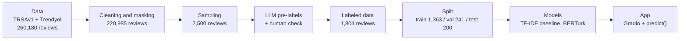

# Turkish Product ABSA

[](https://github.com/ozananr/turkish-product-absa/actions/workflows/ci.yml)

[](LICENSE)

Aspect-based sentiment analysis (ABSA) for Turkish product reviews: detecting **which product aspects** a review talks about and **how the reviewer feels** about each one. A fine-tuned BERTurk model predicts a label for 7 aspects, and a small web app shows the result.

## Example

> *"Ürün çok kaliteli ama kargo çok geç geldi."*
> ("The product is very good quality, but shipping was very late.")

| Aspect | Label |
|---|---|
| `kalite` (quality) | olumlu (positive) |
| `kargo_paketleme` (shipping / packaging) | olumsuz (negative) |
| the other 5 aspects | yok (not mentioned) |

A standard sentiment model gives this review a single label. ABSA separates the opinions per aspect.

**Aspects:** `kalite`, `fiyat`, `kargo_paketleme`, `satici_hizmet`, `islev_performans`, `gorunum_tasarim`, `beden_uyum`.
**Labels:** `yok` (not mentioned), `olumlu`, `olumsuz`, `notr`. Definitions: [`docs/annotation/aspects.md`](docs/annotation/aspects.md).

## Pipeline



| Step | What happens | Details |
|---|---|---|
| Data | Two public review datasets are combined, deduplicated, filtered and personal data is masked | [`docs/data_sources.md`](docs/data_sources.md) |
| Sampling | 2,500 reviews with more negative / neutral reviews and rare aspects | [`docs/labeling_sample.md`](docs/labeling_sample.md) |
| Labeling | An LLM suggests labels, annotators check them in Google Sheets; 200 reviews are labeled twice without suggestions to measure agreement (kappa 0.64) | [`docs/prelabeling.md`](docs/prelabeling.md), [`docs/annotation/`](docs/annotation/labeling_guide.md) |
| Split | Test = the 200 independently labeled reviews; train / val = the checked batches | [`docs/data_split.md`](docs/data_split.md) |
| Models | TF-IDF + logistic regression baseline; BERTurk (`dbmdz/bert-base-turkish-cased`) with 7 classification heads | [`docs/experiment_plan.md`](docs/experiment_plan.md) |
| App | `predict()` loads the model once; Gradio shows the labels per aspect | [`docs/requirements.md`](docs/requirements.md), [`docs/design/`](docs/design/README.md) |

## Results

Test set: 200 reviews with independent human labels (macro-F1 averaged over the 7 aspects).

| Model | val macro-F1 | test macro-F1 |
|---|---:|---:|
| always `yok` | 0.241 | 0.233 |
| TF-IDF + logistic regression | 0.547 | 0.501 |
| **BERTurk** (used in the app) | **0.704** | **0.625** |

- BERTurk is better on every aspect and makes 38% fewer wrong cells than the baseline; contrast ("ama"), negation and short reviews improve most.
- `notr` is never predicted: the training labels contain very few `notr` examples, because the LLM pre-labels almost never use it.
- On CPU, a prediction takes about 0.05 s and the model loads in about 20 s.

Details: [`docs/berturk_results.md`](docs/berturk_results.md), [`docs/baseline_results.md`](docs/baseline_results.md).

## Getting started

Requirements: [Git](https://git-scm.com/) and [uv](https://docs.astral.sh/uv/getting-started/installation/).

```bash
git clone https://github.com/ozananr/turkish-product-absa.git
cd turkish-product-absa
git config core.autocrlf false   # Windows only
uv sync
uv run pre-commit install
```

### Run the app

1. Download the folder `absa-data/models/berturk_v1/` from the restricted Drive folder (see [`data/README.md`](data/README.md)) and put it at **`models/berturk_v1/`** in the repository root. The folder must contain `absa_config.json`.
2. Start the app:

   ```bash
   uv run python app.py
   ```

   The browser opens with the interface. Without the model folder, the app stops with a message.

To try the interface without the model (random but deterministic results):

```bash
ABSA_BACKEND=mock uv run python app.py            # Linux / macOS / Git Bash
$env:ABSA_BACKEND="mock"; uv run python app.py    # Windows PowerShell
```

A different model folder can be set with `ABSA_MODEL_DIR`.

### Use `predict()` in Python

```python
from absa.inference import predict

predict("Ürün çok kaliteli ama kargo çok geç geldi.")
# {"kalite": {"label": "olumlu", "confidence": 0.9759},
#  "fiyat": {"label": "yok", "confidence": 0.9928},
#  "kargo_paketleme": {"label": "olumsuz", "confidence": 0.8359}, ...}  # all 7 aspects
```

The contract (output format, errors, truncation at 128 tokens) is in [`docs/requirements.md`](docs/requirements.md).

### Run the checks

```bash
uv run ruff check .
uv run pytest
```

Without the model, the tests use the mock `predict()` (as in CI). The test plan and the traceability of every requirement are in [`docs/test_plan.md`](docs/test_plan.md).

### Reproduce the data and the models

Data and labels are on Drive ([`data/README.md`](data/README.md) lists every file and the command that creates it). Model commands are in [`docs/experiment_plan.md`](docs/experiment_plan.md); BERTurk was trained on a GPU (Google Colab T4).

## Project structure

```
├── app.py            # Gradio web interface
├── data/             # local data only, never committed (see data/README.md)
├── docs/             # requirements, design, annotation guidelines, results, test plan
├── models/           # trained model, downloaded from Drive, never committed
├── scripts/          # helper scripts (data guard, latency measurement)
├── src/absa/
│   ├── data/         # loading, cleaning, masking, sampling, split
│   ├── labeling/     # LLM pre-labeling, labeling sheets, kappa, adjudication, reports
│   ├── models/       # baseline, BERTurk, evaluation, comparison
│   ├── inference.py  # predict()
│   └── schema.py     # aspect and label names
└── tests/            # tests (pytest)
```

## Documentation

| Document | Content |
|---|---|
| [`docs/requirements.md`](docs/requirements.md) | Functional and non-functional requirements, `predict()` contract |
| [`docs/design/`](docs/design/README.md) | Use case, architecture and sequence diagrams |
| [`docs/test_plan.md`](docs/test_plan.md) | Test strategy, test files, traceability table |
| [`docs/annotation/`](docs/annotation/labeling_guide.md) | Aspect definitions, boundary rules, labeling guide |
| [`docs/data_sources.md`](docs/data_sources.md), [`docs/labeling_sample.md`](docs/labeling_sample.md), [`docs/prelabeling.md`](docs/prelabeling.md), [`docs/data_split.md`](docs/data_split.md) | Data, sampling, LLM pre-labeling, split |
| [`docs/experiment_plan.md`](docs/experiment_plan.md), [`docs/baseline_results.md`](docs/baseline_results.md), [`docs/berturk_results.md`](docs/berturk_results.md) | Experiments and results |

## Team

| Member | GitHub |
|---|---|
| Ozan Anar | [@ozananr](https://github.com/ozananr) |
| Mehmet Salih Kendirkıran | [@MSalih2756](https://github.com/MSalih2756) |
| Yusuf Açık | [@yusufacik26](https://github.com/yusufacik26) |

The team lead (captain) rotated weekly. See [milestones](https://github.com/ozananr/turkish-product-absa/milestones).

## Tech stack

- **Environment:** [uv](https://docs.astral.sh/uv/), Python 3.12
- **Models:** PyTorch, Hugging Face Transformers, BERTurk; scikit-learn for the baseline
- **Interface:** Gradio
- **Code quality:** Ruff, pre-commit, pytest; CI on GitHub Actions

## Contributing

Issue → branch → pull request → 1 approval + passing CI → squash merge.
See [CONTRIBUTING.md](CONTRIBUTING.md) for branch naming, commit conventions and captain duties.

## Data policy

Raw data, labeled data, model weights and secrets are **never** committed. This is enforced by `.gitignore`, a pre-commit hook and a CI check. Data and the model are shared through a restricted Drive folder because the source datasets are licensed.

## License

[MIT](LICENSE)
