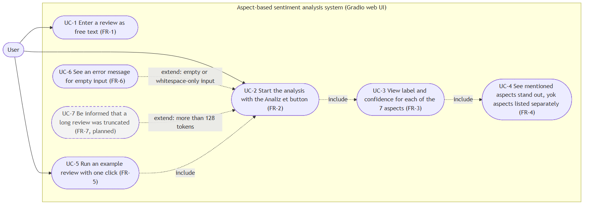
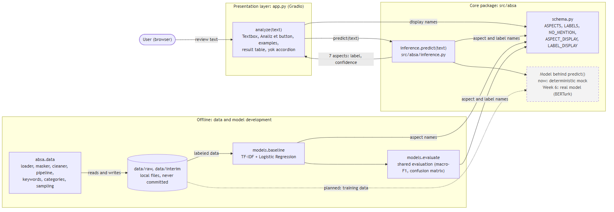
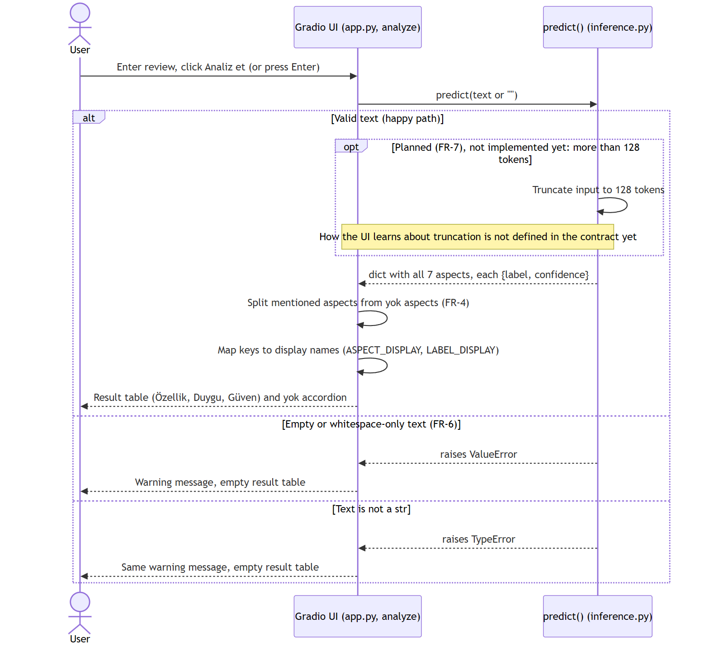

# System Design

Design documentation for the aspect-based sentiment analysis (ABSA) system. All diagrams match [`../requirements.md`](../requirements.md) (names, flows, error behaviour) and the code in `app.py`, `src/absa/inference.py` and `src/absa/schema.py`.

Each diagram has an editable **Mermaid source** (`src/*.mmd`) and a rendered **PNG** (`img/*.png`). Mermaid also renders directly on GitHub, so the sources can be reviewed in the pull request.

| Diagram | Source | Image |
|---|---|---|
| Use case | [`src/use_case.mmd`](src/use_case.mmd) | [`img/use_case.png`](img/use_case.png) |
| Component / architecture | [`src/architecture.mmd`](src/architecture.mmd) | [`img/architecture.png`](img/architecture.png) |
| Sequence (with error path) | [`src/sequence.mmd`](src/sequence.mmd) | [`img/sequence.png`](img/sequence.png) |

Dashed boxes and arrows mean *planned, not implemented yet*.

## 1. Use case diagram



The only actor is the **User**, who enters a review and sees the aspect results in the web interface.

| Use case | Requirement | Status |
|---|---|---|
| UC-1 Enter a review as free text | FR-1 | Implemented |
| UC-2 Start the analysis with the **Analiz et** button | FR-2 | Implemented |
| UC-3 View label and confidence for each of the 7 aspects | FR-3 | Implemented (mock model) |
| UC-4 See mentioned aspects stand out, `yok` aspects listed separately | FR-4 | Implemented |
| UC-5 Run an example review with one click | FR-5 | Implemented |
| UC-6 See an error message for empty input | FR-6 | Implemented |
| UC-7 Be informed that a long review was truncated | FR-7 | **Planned**, not implemented |

UC-6 and UC-7 *extend* UC-2: they happen only for special input (empty text, more than 128 tokens).

Out of scope (`requirements.md` section 1): extracting aspect terms as free text, languages other than Turkish, storing user input or analysis history, batch analysis.

## 2. Component / architecture diagram



| Component | Where | Responsibility |
|---|---|---|
| Gradio UI | `app.py` (`analyze()`) | Textbox, **Analiz et** button, examples, result table, `yok` accordion. Catches `ValueError` and `TypeError` and shows a warning. |
| `predict()` | `src/absa/inference.py` | The contract between UI and model: `predict(text)` returns all 7 aspects with `label` and `confidence`. |
| Schema | `src/absa/schema.py` | Single definition of `ASPECTS`, `LABELS`, `NO_MENTION` and the display names. Imported everywhere else. |
| Model | behind `predict()` | Today a deterministic mock. Replaced by the real model in Week 6 without UI changes. |
| Data tools | `src/absa/data/` | Loading, cleaning, masking, keyword and category rules, sampling. Work on local files in `data/raw` and `data/interim`, which are never committed. |
| Baseline | `src/absa/models/baseline.py` | TF-IDF + Logistic Regression, one classifier per aspect. |
| Evaluation | `src/absa/models/evaluate.py` | One shared evaluation function for all models. |

Design rule: aspect and label names are defined once in `schema.py`, so the UI, `predict()`, the baseline and the evaluation always agree.

## 3. Sequence diagram



- **Happy path:** the user submits text, the UI calls `predict(text)`, receives all 7 aspects, splits mentioned aspects from `yok` aspects (FR-4), maps keys to display names and shows the table.
- **Error path (FR-6):** empty or whitespace-only text makes `predict()` raise `ValueError`, a non-`str` input raises `TypeError`. The UI catches both and shows a warning with an empty table instead of a result. From the web interface the textbox value is passed as `text or ""`, so an empty box always leads to `ValueError`.
- **Planned (FR-7):** input longer than 128 tokens is truncated and the user is informed. The contract does not yet define how the UI learns about truncation; this must be decided before it is implemented.

Contract details (rules, error table) are in `requirements.md` section 5. The tests that check them are listed in [`../test_plan.md`](../test_plan.md).

## 4. Regenerating the images

Edit the `.mmd` source, then render it with [mermaid-cli](https://github.com/mermaid-js/mermaid-cli). It needs Node.js and a Chrome installation; nothing is added to the project dependencies.

```bash
cd docs/design
npx -y @mermaid-js/mermaid-cli@11 -i src/use_case.mmd -o img/use_case.png -s 2 -b white
npx -y @mermaid-js/mermaid-cli@11 -i src/architecture.mmd -o img/architecture.png -s 2 -b white
npx -y @mermaid-js/mermaid-cli@11 -i src/sequence.mmd -o img/sequence.png -s 2 -b white
```

If `mmdc` cannot find a browser, pass `-p puppeteer.json` with `{"executablePath": "<path to chrome>", "args": ["--no-sandbox"]}`. Alternatively paste the source into <https://mermaid.live> and export a PNG.

Mermaid has no native UML use case diagram type, so the use case diagram is drawn as a flowchart with ovals (use cases) inside a system boundary and dotted `include` / `extend` arrows.
