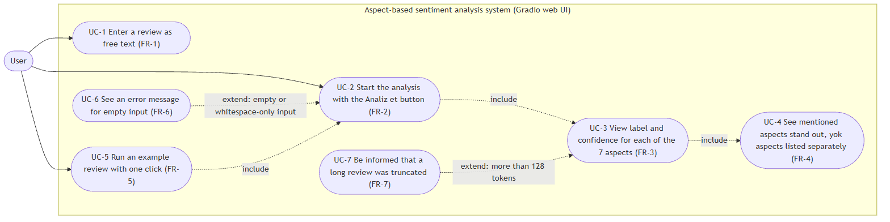
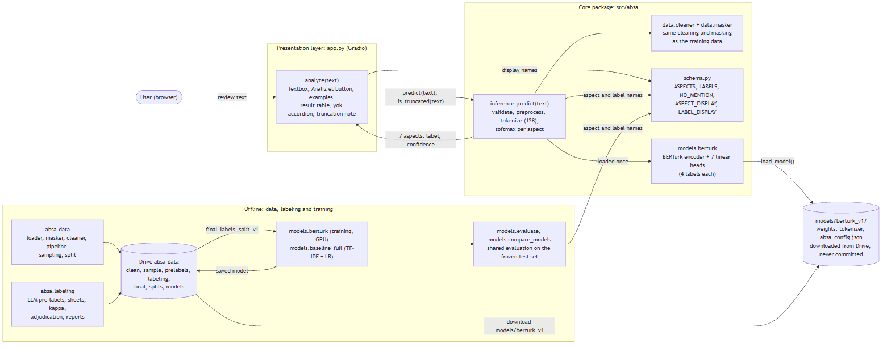
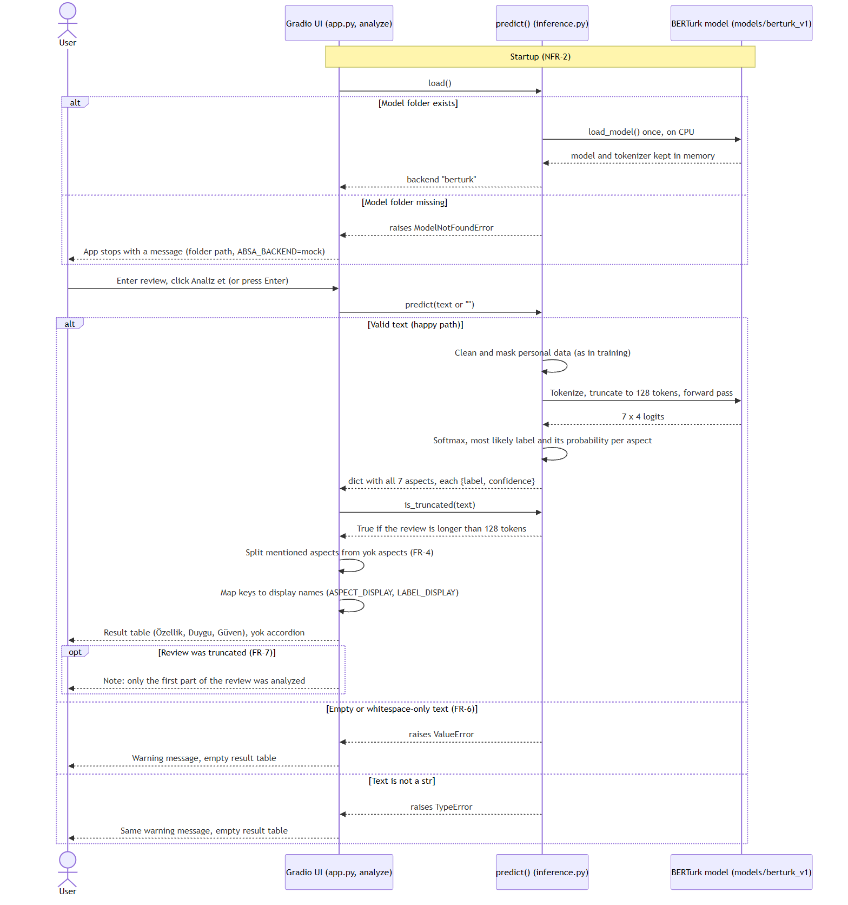

# System Design

Design documentation for the aspect-based sentiment analysis (ABSA) system with the trained BERTurk model. All diagrams match [`../requirements.md`](../requirements.md) (names, flows, error behaviour) and the code in `app.py`, `src/absa/inference.py`, `src/absa/models/berturk.py` and `src/absa/schema.py`.

Each diagram has an editable **Mermaid source** (`src/*.mmd`) and a rendered **PNG** (`img/*.png`). Mermaid also renders directly on GitHub, so the sources can be reviewed in the pull request.

| Diagram | Source | Image |
|---|---|---|
| Use case | [`src/use_case.mmd`](src/use_case.mmd) | [`img/use_case.png`](img/use_case.png) |
| Component / architecture | [`src/architecture.mmd`](src/architecture.mmd) | [`img/architecture.png`](img/architecture.png) |
| Sequence (with error paths) | [`src/sequence.mmd`](src/sequence.mmd) | [`img/sequence.png`](img/sequence.png) |

## 1. Use case diagram



The only actor is the **User**, who enters a review and sees the aspect results in the web interface.

| Use case | Requirement | Status |
|---|---|---|
| UC-1 Enter a review as free text | FR-1 | Implemented |
| UC-2 Start the analysis with the **Analiz et** button | FR-2 | Implemented |
| UC-3 View label and confidence for each of the 7 aspects | FR-3 | Implemented (BERTurk) |
| UC-4 See mentioned aspects stand out, `yok` aspects listed separately | FR-4 | Implemented |
| UC-5 Run an example review with one click | FR-5 | Implemented (4 examples) |
| UC-6 See an error message for empty input | FR-6 | Implemented |
| UC-7 Be informed that a long review was truncated | FR-7 | Implemented |

UC-6 *extends* the analysis for empty input, UC-7 *extends* the result for reviews longer than 128 tokens. The traceability of every requirement to a test is in [`../test_plan.md`](../test_plan.md), section 4.

Out of scope (`requirements.md` section 1): extracting aspect terms as free text, languages other than Turkish, storing user input or analysis history, batch analysis.

## 2. Component / architecture diagram



| Component | Where | Responsibility |
|---|---|---|
| Gradio UI | `app.py` (`analyze()`) | Textbox, **Analiz et** button, examples, result table, `yok` accordion, truncation note. Loads the model at startup and stops with a message if it is missing. Catches `ValueError` and `TypeError` and shows a warning. |
| `predict()` | `src/absa/inference.py` | The contract between UI and model. Validates the input, applies the same cleaning and masking as the training data, tokenizes with a 128-token limit and returns all 7 aspects with `label` and `confidence` (softmax probability). `is_truncated()` tells the UI whether the review was cut. |
| Preprocessing | `src/absa/data/cleaner.py`, `masker.py` | `normalize_text()` and `mask_personal_data()`, shared by the data pipeline and `predict()`. |
| BERTurk model | `src/absa/models/berturk.py` | `dbmdz/bert-base-turkish-cased` encoder with 7 linear heads (one per aspect, 4 labels each). `load_model()` reads the folder `models/berturk_v1/`. |
| Model files | `models/berturk_v1/` | Weights, tokenizer and `absa_config.json` (aspects, labels, max length, training settings). Downloaded from Drive, never committed. `ABSA_MODEL_DIR` sets another folder; `ABSA_BACKEND=mock` uses a deterministic mock without a model (CI, UI development). |
| Schema | `src/absa/schema.py` | Single definition of `ASPECTS`, `LABELS`, `NO_MENTION` and the display names. |
| Data tools | `src/absa/data/` | Loading, cleaning, masking, sampling, train / val / test split. |
| Labeling tools | `src/absa/labeling/` | LLM pre-labels, labeling sheets, kappa, adjudication, LLM–human report. |
| Training and evaluation | `src/absa/models/` | BERTurk training (GPU), TF-IDF baseline, shared `evaluate()`, model comparison on the frozen test set. |

Design rules:
- Aspect and label names are defined once in `schema.py`, so the UI, `predict()`, the models and the evaluation always agree.
- `predict()` applies the same preprocessing as the training data, so the model sees masked text in both cases.
- The model is loaded once and kept in memory; every request only runs a forward pass.

## 3. Sequence diagram



- **Startup (NFR-2):** `app.py` calls `load()`. The model is read once from `models/berturk_v1/` and kept in memory. If the folder is missing, `ModelNotFoundError` stops the app with a message that names the folder and the mock option.
- **Happy path:** the UI calls `predict(text)`. The text is cleaned and masked, tokenized and truncated to 128 tokens, and one forward pass gives 7 × 4 logits. The most likely label per aspect and its probability are returned. The UI splits mentioned aspects from `yok` aspects (FR-4) and maps keys to display names.
- **Truncation (FR-7):** the UI asks `is_truncated(text)` and, for reviews longer than 128 tokens, shows a note that only the first part was analyzed. 5 of the 1,804 labeled reviews are that long.
- **Error path (FR-6):** empty or whitespace-only text makes `predict()` raise `ValueError`, a non-`str` input raises `TypeError`. The UI catches both and shows a warning with an empty table.

Measured on CPU: loading about 20 s, one prediction about 0.05 s ([`../test_plan.md`](../test_plan.md), section 3.3).

## 4. Regenerating the images

Edit the `.mmd` source, then render it with [mermaid-cli](https://github.com/mermaid-js/mermaid-cli). It needs Node.js and a Chrome installation; nothing is added to the project dependencies.

```bash
cd docs/design
npx -y @mermaid-js/mermaid-cli@11 -i src/use_case.mmd -o img/use_case.png -s 2 -b white
npx -y @mermaid-js/mermaid-cli@11 -i src/architecture.mmd -o img/architecture.png -s 2 -b white
npx -y @mermaid-js/mermaid-cli@11 -i src/sequence.mmd -o img/sequence.png -s 2 -b white
```

If `mmdc` cannot find a browser, pass `-p puppeteer.json` with `{"executablePath": "<path to chrome>", "args": ["--no-sandbox"]}`. Alternatively paste the source into <https://mermaid.live> and export a PNG.

Mermaid has no native UML use case diagram type, so the use case diagram is drawn as a flowchart with ovals (use cases) inside a system boundary and dotted `include` / `extend` arrows.
